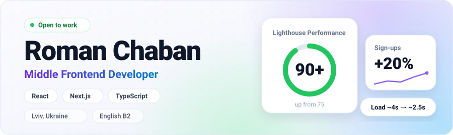

I build web applications for HR Tech and e-commerce platforms, working with SSR, GraphQL, payment flows, and web performance. I have 2+ years of commercial experience and use Feature-Sliced Design to keep codebases maintainable as they grow.

📍 Lviv, Ukraine · 🟢 Open to work · 🗣 English B2

## Selected Impact

Also built the payment modal for Premium and Bump promotions (Portmanat, Yigim), with success, failure, and redirect handling.

## Tech Stack

  

## Featured Projects

**[DreamSpace Interiors](https://dream-space-interiors.vercel.app/)** · [Code](https://github.com/chaban1001/DreamSpace-Interiors) 
Interior design platform with an inspiration gallery, project planning tools, and location-based showroom search. 
`Next.js` `TypeScript` `Redux Toolkit` `Google Maps API` `Framer Motion`

**[iMarketplace](https://roman-chaban.github.io/iMarketplace/)** · [Code](https://github.com/chaban1001/iMarketplace) 
Online store for Apple products: iPhones, iPads, and accessories. 
`React` `Vite` `TypeScript` `Redux Toolkit` `React Router`

**[Clothings Store](https://clothing-store-tau-drab.vercel.app/)** · [Code](https://github.com/chaban1001/Clothings-Store) 
Online fashion store with product browsing, a responsive UI, and state that persists across sessions. 
`Next.js` `TypeScript` `Redux Toolkit` `Redux Persist` `Swiper`

## Get in Touch

  
  
  

